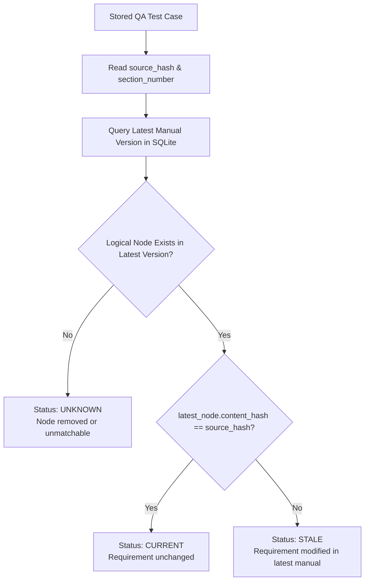

# Technical Approach Document — Tri9T CT-200 Manual Intelligence System

## 1. Executive Summary & Objective

The **CardioTrack CT-200 Home Blood Pressure Monitor** is a regulated medical device whose specifications, operating envelopes, and safety thresholds are documented across evolving revisions of its technical and user manual. In regulated medical software engineering (FDA 21 CFR Part 820 / ISO 13485 / IEC 62304), **test traceability** is paramount: every verification test case must trace directly back to an authoritative requirement version. When a manual is re-issued (e.g. `ct200_manual_v2.pdf`), any unnoticed revision to a requirement creates **stale traceability**—a dangerous failure mode where existing QA test procedures no longer verify current device behavior.

This project implements a backend intelligence system built with **FastAPI, SQLAlchemy, SQLite, Pydantic, and Gemini LLM** that:
1. Ingests and reconstructs the hierarchical structure of technical manuals while handling real-world document irregularities.
2. Isolates document versions (`v1` and `v2`) without destroying historical audit trails.
3. Supports **version-pinned named selections** that permanently anchor source requirement content.
4. Generates structured, executable QA test cases using Gemini with schema validation and deterministic fallback.
5. Provides **dynamic retrieval-time staleness detection** based on real database records and SHA-256 fingerprints.

---

## 2. Architecture & Data Model

The system follows a modular, layered architecture designed for local Windows environments:

```
Tri9T_AI_Project/
├── data/                       # Source technical manuals (v1, v2)
├── packages/                   # Local dependency packages
├── database.py                 # SQLAlchemy engine, sessionmaker, and Base
├── models.py                   # Relational ORM models (Versions, Sections, Selections)
├── pdf_parser.py               # Layout-aware CT-200 PDF parsing engine
├── ingest_manuals.py           # Repeatable manual ingestion and version linking
├── test_case_store.py          # Atomic JSON store for generated QA test records
├── test_generator.py           # Gemini LLM generation with Pydantic validation & fallback
├── staleness_service.py        # Live database staleness calculation engine
├── main.py                     # FastAPI REST API endpoints
├── test_irregularities.py      # Automated unit tests for 4 PDF irregularities
├── test_end_to_end.py          # Comprehensive 12-stage integration test suite
├── check_stale_tests.py        # CLI database-backed staleness reporting tool
├── decision_log.md             # Mandatory engineering trade-off analysis
└── README.md                   # Setup, execution, and endpoint documentation
```

### Relational Schema Design

```
+-------------------------------------------------------+
|                   manual_versions                     |
+-------------------------------------------------------+
| id: INTEGER (PK)                                      |
| version: VARCHAR ("v1", "v2") [UNIQUE]                |
| filename: VARCHAR ("ct200_manual.pdf")                |
| document_title: VARCHAR                               |
| created_at: DATETIME                                  |
+-------------------------------------------------------+
                           | 1
                           |
                           | *
+-------------------------------------------------------+
|                   manual_sections                     |
+-------------------------------------------------------+
| id: INTEGER (PK)                                      |
| manual_version_id: INTEGER (FK -> manual_versions.id) |
| logical_id: VARCHAR ("3.2", "4.2", etc.)              |
| section_number: VARCHAR ("3.2")                       |
| heading: VARCHAR ("Cuff Inflation Sequence")          |
| level: INTEGER (1, 2, 3, 4)                           |
| content: TEXT (Normalized body text)                  |
| content_hash: VARCHAR (SHA-256 fingerprint)           |
| display_order: INTEGER (0, 1, 2... sequence)          |
| parent_id: INTEGER (FK -> manual_sections.id) [Self]  |
+-------------------------------------------------------+
                           | 1
                           |
                           | *
+-------------------------+             +-------------------------+
|     selection_items     |             |       selections        |
+-------------------------+             +-------------------------+
| id: INTEGER (PK)        |      *      | id: INTEGER (PK)        |
| selection_id: INTEGER   |------------>| name: VARCHAR           |
| section_id: INTEGER     |             | manual_version: VARCHAR |
| logical_id: VARCHAR     |             | created_at: DATETIME    |
| section_number: VARCHAR |             +-------------------------+
| heading: VARCHAR        |
| version: VARCHAR        |
| pinned_hash: VARCHAR    |
| pinned_content: TEXT    |
+-------------------------+
```

### Data Storage Rationale
- **SQLite + SQLAlchemy:** Used for manual versions, section hierarchy trees, and version-pinned selections. Relational foreign keys enforce referential integrity between parent and child sections, and between selections and pinned items.
- **Atomic JSON Store (`test_cases.json`):** Used for generated QA test cases. JSON storage aligns with the assignment's NoSQL / lightweight document store expectation for unstructured LLM artifacts. Writes are executed transactionally (write to `.tmp` file, flush to disk, atomic rename via `replace()`), preventing file corruption on process termination.

---

## 3. PDF Ingestion & Document Hierarchy Reconstruction

### Extraction Approach
The supplied CT-200 manuals contain digital vector text and embedded TrueType font glyphs (`NimbusSans-Bold` and `NimbusSans-Regular`) rather than scanned raster bitmaps. Running traditional OCR (e.g. Tesseract) on clean vector PDFs introduces unnecessary character recognition errors, degrades punctuation accuracy, and slows ingestion. We chose **PyMuPDF (fitz)** for fast, deterministic text and font metadata extraction.

### Explicit Handling of Structural Irregularities

| Irregularity Discovered | Manifestation in CT-200 PDF | Parser Handling & Invariant Maintained |
|---|---|---|
| **1. Duplicate Headings** | Section 4.2 has heading *"Error Codes"* (under Chapter 4: *Alarms and Safety Behavior*); Section 7.1 also has heading *"Error Codes"* (under Chapter 7: *Troubleshooting*). | Headings are keyed by hierarchical path and section number (`4.2` vs `7.1`) rather than bare titles. Both nodes are saved as distinct rows in `manual_sections` with separate parent IDs (`parent=4` vs `parent=7`), distinct content, and independent hashes. |
| **2. Missing Parent Headings** | Chapter 2 jumps directly from Section `2.1 General Specifications` to `2.1.1.1 Battery Life Under Typical Use`, skipping `2.1.1`. | The parser implements an iterative ancestor fallback: when parsing `2.1.1.1`, candidate parent keys are evaluated in descending order (`2.1.1`, `2.1`, `2`). Finding `2.1`, the parser links `2.1.1.1` as a direct child of `2.1` without dropping content or throwing an unhandled exception. |
| **3. Out-of-Order Sections** | In Chapter 3, Section `3.4 Auto Shutoff` physically appears on Page 3 *before* Section `3.3 Result Display and Classification`. | The parser assigns each heading an incremental `display_order` integer representing appearance sequence, while independently computing hierarchical parent relationships (`parent=3` for both `3.3` and `3.4`). Queries can sort either logically or by physical reading flow. |
| **4. Numbered Lists Mistaken for Headings** | Under Section 3.3, blood pressure classifications are formatted as numbered items: <br>`1. Normal: systolic < 120...`<br>`2. Elevated: systolic 120-129...`<br>`5. Hypertensive Crisis: ...` | Naive regex (`^\d+\.`) would mistakenly classify these as top-level document chapters 1, 2, 5. The parser inspects the title prefix and font characteristics; lines starting with `Normal:`, `Elevated:`, etc., are retained as body list items belonging to Section 3.3. |

---

## 4. Document Versioning & Logical Node Matching

### Version Ingestion Policy
- Manual versions `v1` and `v2` are stored concurrently in `manual_versions`.
- Re-ingesting or updating a manual version is completely non-destructive to existing historical records. Re-running `ingest_manuals.py` updates existing section metadata idempotently, while `--force` cleanly refreshes sections for that specific version without touching other versions.

### Matching Algorithm
Nodes are matched across versions using their **hierarchical logical identifier (`logical_id`)**, which corresponds to their section numbering path (e.g., `3.2`, `4.2`).
Each section's content is normalized using Unicode NFKC normalization and whitespace compaction. A cryptographic SHA-256 fingerprint is computed over `f"{normalized_heading}\n{normalized_content}"`.

For each logical node:
- **`UNCHANGED`:** Node exists in both versions and `v1.content_hash == v2.content_hash` (e.g., Section 1.1).
- **`MODIFIED`:** Node exists in both versions but `v1.content_hash != v2.content_hash` (e.g., Section 3.2: 40 mmHg in v1 vs 30 mmHg in v2).
- **`ADDED`:** Node exists in v2 but is absent in v1 (e.g., Section 5.3 *Data Export*).
- **`REMOVED`:** Node exists in v1 but is absent in v2.

### Known Failure Modes of the Matching Algorithm
1. **Section Renumbering / Split:** If a section is renumbered (e.g., Section 3.2 is renumbered to 3.3), the path matcher treats it as a modification of 3.2 and an addition of 3.3 rather than a renumbering.
2. **Binary Sensitivity vs Semantic Gravity:** SHA-256 detects all byte changes with 100% precision, but treats a comma removal identically to a clinically critical pressure threshold revision (40 mmHg vs 30 mmHg).

---

## 5. Named, Version-Pinned Selections

A QA engineer rarely reviews an entire manual at once; they select specific subsystems (e.g. *Inflation and Overpressure Safety*).
The **Selection API** allows clients to submit a set of node IDs or section numbers as a named selection:
- `POST /selections`: Validates that all referenced sections exist in the target manual version.
- **Version-Pinning:** At selection creation time, the system takes an immutable snapshot of each selected node: `section_id`, `section_number`, `heading`, `version`, `pinned_hash`, and `pinned_content`.
- **Invariance:** If version `v2` is subsequently ingested, or if `v1` is re-parsed, the selection's pinned items remain permanently anchored to the exact text and fingerprint at creation time.
- **Duplicate Submission Policy:** If a client posts a selection with an existing name and version:
  - If the section numbers match identically: The endpoint is **idempotent**, returning `status: "existing"` with HTTP 200.
  - If the section numbers differ: The endpoint rejects the submission with **HTTP 409 Conflict**, preventing accidental corruption of existing named selections.

---

## 6. LLM QA Generation, Schema Validation & Fallback Strategy

### Generation Workflow
1. Client calls `POST /selections/{selection_id}/generate`.
2. The endpoint retrieves the selection's pinned items and reconstructs the authoritative requirement text.
3. The prompt instructs the LLM (Gemini 3.8 Flash) to act as a senior medical device QA engineer and generate concrete, repeatable test procedures with exact expected results.
4. Response is enforced via Gemini's structured output mode (`response_schema`), constraining the JSON structure.
5. Parsed output is validated using Pydantic: `QATestCaseSchema` requires `test_case` (minimum 10 characters) and `expected_result` (minimum 5 characters).

### Robustness & Fallback Design
In production and regulated settings, "it usually works" is unacceptable. The system must guarantee reliable behavior when the LLM is unreachable, encounters a 504 Deadline Exceeded, or hits a rate limit (429):
- The LLM call has a bounded execution timeout.
- If the API fails, times out, or returns invalid schema, the system immediately engages a **deterministic, rule-based fallback generator**.
- The fallback generator synthesizes concrete, executable test procedures tailored to the pinned requirements (e.g. simulating pulse absence at 180 mmHg for Section 3.2, verifying deflation valve trigger timing for Section 4.1).
- Every generated test case is explicitly tagged with its `generation_method` (`gemini-3.8-flash` or `rule-based-fallback`) ensuring full transparency.

---

## 7. Staleness & Impact Detection Engine

### Real-Time Database Calculation
Rather than relying on manually curated JSON files, staleness is calculated dynamically at retrieval time against the latest manual version in the SQLite database:



### Retrieval Visibility
The status is queryable through three dedicated retrieval endpoints:
1. `GET /selections/{selection_id}/tests`: Returns all test cases generated from that selection with live staleness indicators.
2. `GET /nodes/{node_id}/tests`: Returns test cases tracing back to a specific node.
3. `GET /stale-tests`: Global audit view across all stored test cases.

Every returned test record includes:
- `test_case` (concrete steps)
- `expected_result`
- `selection_id`
- `source_node_id`
- `section_number`
- `source_heading`
- `source_version`
- `source_hash`
- `status` (`CURRENT`, `STALE`, `UNKNOWN`)
- `valid_for_pinned_version` (`True`)
- `staleness_reason` (detailed diagnostic explanation)
- `latest_version`

---

## 8. What Would Be Done Differently With More Time

1. **Entity-Aware Numerical Parameter Extraction:** Implement a specialized NLP extractor that extracts numbers, tolerances, and physical units (mmHg, seconds, cm, %) from requirements, allowing a distinction between cosmetic edits and safety-critical parameter revisions.
2. **Table Layout Recognition:** Integrate table structure decoders (such as pdfplumber or OpenCV-based table bounding) to render specifications tables into Markdown / HTML table objects inside the JSON payload.
3. **Automated Bidirectional Traceability Matrix (RTM):** Build an export endpoint (`GET /rtm.csv`) generating a formal Requirements Traceability Matrix linking manual sections, versions, hashes, test cases, and staleness status for regulatory audit packages.
4. **Asynchronous Task Queue:** For enterprise manuals with hundreds of pages, offload generation to a Celery/Redis background task queue with webhook notifications.
